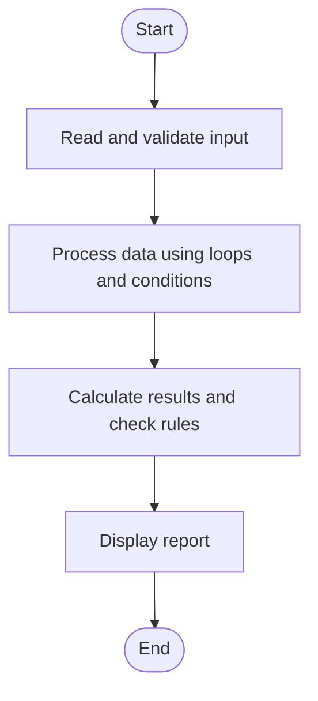

# Case Study 17: Student Performance Trend Analysis

## 1. Problem Statement
Compare scores across multiple examinations, calculate improvements or declines, identify weak subjects, and classify performance using supplied thresholds.

## 2. Objectives
- Calculate score changes between exams.
- Find the lowest-scoring subject.
- Assign a performance category using defined rules.

## 3. Assumptions
- Each subject has a score from 0 to 100 for both examinations.
- A score change is latest score minus previous score.
- Average >= 75 is High, >= 50 is Moderate, otherwise Needs Improvement.

## 4. Algorithm
1. Read subject names and two scores for each subject.
2. Validate scores from 0 to 100.
3. Calculate change and average latest score.
4. Identify the subject with the lowest latest score.
5. Classify the average and display the report.

## 5. Flowchart


## 6. Pseudocode
```text
INPUT subject count
FOR each subject: INPUT name, previous, latest
    change = latest - previous
    store latest score
average = sum(latest scores) / count
weakest = subject with minimum latest score
IF average >= 75: category = High
ELSE IF average >= 50: category = Moderate
ELSE: category = Needs Improvement
PRINT each change, average, weakest, category
```

## 7. Python Source Code
See [`program.py`](program.py).

## 8. Test Cases
| Test input / condition | Expected result |
|---|---|
| Math 60->80; English 70->75 | Math +20, English +5; average 77.5; High |
| Math 40->45; English 50->45 | average 45; Needs Improvement |
| Math 65->65 | change 0; Unchanged |

## 9. Sample Output
The `output_screenshot.png` file in this folder is a sample terminal-style output illustration. Run `program.py` with the test input to verify the actual output on your system.

## 10. Conclusion
The analysis reports subject-wise trends and gives a simple overall classification from the latest scores.
